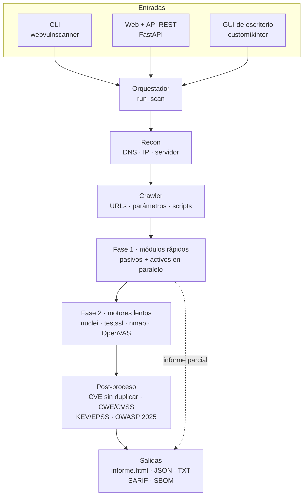

<div align="center">

# 🛡️ WebVulnScanner

**Audita la superficie de seguridad externa de un dominio y la explica en un informe que se entiende sin ser experto.**


</div>

> [!WARNING]
> El escaneo es **activo**: envía peticiones de prueba al objetivo (inyecciones, fuzzing, ráfagas de
> rate limiting, nuclei, nmap…). Úsalo solo sobre dominios propios o con autorización expresa por escrito.

Le das un dominio y corre **41 módulos** de análisis (TLS, cabeceras, DNS y correo, subdominios,
archivos expuestos, inyecciones, control de acceso, CVEs) junto con motores externos de referencia:
nuclei, testssl.sh, sslyze, nmap, WPScan y OpenVAS. Entrega una **nota A–F**, cada hallazgo con su
riesgo, CWE, CVSS y categoría OWASP 2025, y un informe HTML que aparece en minutos y se completa solo
cuando terminan los análisis lentos.

## Cómo funciona



1. **Recon** resuelve el dominio y detecta servidor y versión. Si el dominio no resuelve, el escaneo termina ahí.
2. **Crawler** recorre el sitio y comparte URLs, parámetros, formularios y scripts con los módulos que los usan.
3. **Fase 1**: los módulos rápidos corren en paralelo y se escribe un informe parcial.
4. **Fase 2**: terminan los motores lentos y el informe se actualiza solo.
5. **Post-proceso**: quita CVE repetidos, añade CWE, CVSS y explotabilidad (CISA KEV, EPSS), etiqueta OWASP y calcula la nota.

Si un módulo falla, el escaneo sigue y lo anota. Si falta un motor externo, su módulo se omite y el
informe dice cómo instalarlo. El detalle de cada pieza está en [docs/ARQUITECTURA.md](docs/ARQUITECTURA.md).

## Inicio rápido

**Con Docker.** La imagen trae todos los motores externos menos OpenVAS.

```bash
make docker                                              # construye webvulnscanner:2.0
docker run --rm -v "$PWD:/reports" webvulnscanner:2.0 tu-dominio.com
# → informes/tu-dominio.com/informe.html
```

**Desde el código.**

```bash
python -m venv .venv && source .venv/bin/activate
make dev                          # paquete + gui + api + herramientas de desarrollo
pip install -e ".[enhanced,apifuzz]"   # opcional: sslyze, Wappalyzer, schemathesis…
webvulnscanner --check-tools      # qué motores tienes y cómo instalar los que faltan
webvulnscanner tu-dominio.com
```

## Formas de usarlo

| Interfaz | Cómo se abre | Para qué |
|---|---|---|
| CLI | `webvulnscanner <dominio>` | escaneos puntuales, scripts, pipelines |
| Web | `make api` → http://localhost:8000 | pegar una URL y ver el informe en vivo |
| API REST | `POST /scan` · `POST /ui/scan` | integrarlo con otras herramientas |
| GUI de escritorio | `webvulnscanner-gui` | uso local con ventana |
| Laboratorio de red | `webvulnscanner-covert demo` | canal encubierto en el IP ID (capa 3/4) |

### CLI

```bash
webvulnscanner tu-dominio.com                       # todo → informes/tu-dominio.com/
webvulnscanner tu-dominio.com --profile quick       # recon, tls, headers, waf, fingerprint
webvulnscanner tu-dominio.com --only tls,dns        # solo esos módulos
webvulnscanner tu-dominio.com --skip nuclei,openvas # todo menos esos
webvulnscanner tu-dominio.com --sarif --sbom sbom.json
webvulnscanner tu-dominio.com --diff informes/tu-dominio.com/reporte_anterior.json
webvulnscanner tu-dominio.com --cookie 'sid=abc' --rps 5   # zona autenticada, 5 peticiones/s
```

- Perfiles: `full` (por defecto), `quick`, `tls`, `web`, `dns`.
- `--write-baseline .wvsignore` acepta los hallazgos actuales; los siguientes escaneos los ocultan.
- Sale con **código 2** si hay hallazgos de riesgo alto, útil para cortar un pipeline.

### Web y API REST

| Método | Ruta | Qué hace |
|---|---|---|
| `GET` | `/` | formulario: pegas el dominio y arranca |
| `POST` | `/ui/scan` | lanza el escaneo en segundo plano → `{job_id, url}` |
| `GET` | `/ui/report/{job_id}` | informe HTML que se recarga solo hasta terminar |
| `POST` | `/scan` | escaneo síncrono → `{nota, puntaje, reporte}` en JSON |
| `GET` | `/health` | estado, versión y lista de módulos |

```bash
curl -X POST localhost:8000/scan -H 'Content-Type: application/json' \
     -d '{"dominio": "tu-dominio.com", "activos": ["recon", "tls", "headers"]}'
```

> [!CAUTION]
> No publiques la web ni la API sin autenticación: cualquiera podría usarlas para escanear a
> terceros desde tu servidor. El despliegue de producción las pone detrás de Traefik con basic auth.

## Qué revisa

| Área | Qué busca | Módulos |
|---|---|---|
| Reconocimiento | IP, puertos y banners, WAF/CDN, tecnologías y versiones, subdominios, Shodan | `recon` `ports` `waf` `fingerprint` `stack` `subdomains` `subfinder` `shodan` |
| TLS | protocolos y cifrados débiles, certificado, Heartbleed/ROBOT | `tls` `tls_deep` `testssl` |
| Navegador | CSP, HSTS, mixed content, SRI, cookies, CORS, CSRF | `headers` `webchecks` `cookies` `cors` `csrf` |
| DNS y correo | SPF, DMARC, DKIM, CAA, DNSSEC, AXFR, MTA-STS, TLS-RPT | `dns` `mail_transport` |
| Exposición | `.git`, `.env`, backups, secretos en JS, librerías vulnerables, buckets cloud, supply chain | `disclosure` `secrets` `retirejs` `cloud` `sbom` |
| CMS y frameworks | WordPress, Drupal, Joomla, Laravel, paneles de administración | `wordpress` `frameworks` `wpscan` |
| APIs | OpenAPI/GraphQL expuestos, JWT débiles, fuzzing por contrato, rate limiting | `api` `jwt` `api_fuzz` `rate_limit` |
| Ataque activo | XSS/SQLi, open redirect, rutas ocultas, IDOR, autenticación, SSRF, errores con traza | `inyeccion` `open_redirect` `fuzzing` `access_control` `auth_test` `ssrf` `error_audit` |
| Vulnerabilidades conocidas | CVE por versión (NVD), plantillas nuclei, `nmap --script vuln`, OpenVAS | `cve` `nuclei` `nmap` `openvas` |

El catálogo completo, con fase y motor de cada módulo, está en [docs/ARQUITECTURA.md](docs/ARQUITECTURA.md#catálogo-de-módulos).

## Qué entrega

Cada escaneo escribe en `informes/<dominio>/`:

| Archivo | Contenido |
|---|---|
| `informe.html` | informe de 3 pestañas: **Informe** (nota, hallazgos por riesgo, controles PCI-DSS / ISO 27001 / NIST afectados), **Inteligencia** (tecnologías, certificado, cobertura de módulos) y **Qué revisa**. Se recarga solo mientras corre la fase 2 |
| `reporte_<dominio>_<fecha>.json` | resultado completo; es la entrada de `--diff` |
| `reporte_<dominio>_<fecha>.txt` / `.html` | versión de consola y HTML simple |
| `.sarif` (con `--sarif`) | para GitHub code scanning, Azure DevOps o GitLab |
| SBOM (con `--sbom`) | CycloneDX con los componentes detectados |

## Despliegue

| Escenario | Comando | OpenVAS |
|---|---|---|
| Local | `docker run` del inicio rápido | no |
| Todo en uno con Greenbone | `GVM_PASSWORD='clave-fuerte' ./deploy/setup.sh` | sí; la primera vez el feed tarda horas |
| Servidor con Traefik | `bash deploy/desplegar.sh` | no |

Cómo encaja cada uno: [docs/ARQUITECTURA.md › Despliegue](docs/ARQUITECTURA.md#despliegue).

## Estructura

```text
.
├── src/webvulnscanner/   # paquete: núcleo, orquestador, salidas, CLI, API y GUI
│   ├── modules/          # un archivo por capacidad de análisis
│   └── covert/           # laboratorio de canal encubierto (capa 3/4)
├── tests/                # suite de pytest
├── deploy/               # compose de Greenbone, compose de producción y scripts
├── docs/                 # arquitectura, roadmap, playbook del informe, presentación
├── openspec/             # specs de cada capacidad de seguridad
├── Dockerfile            # imagen con motores externos (CLI y web)
└── Makefile              # dev, check, cov, api, docker…
```

## Desarrollo

```bash
make dev     # instala con extras de desarrollo
make check   # ruff (lint + formato) + mypy + pytest
make cov     # cobertura
```

No hay CI: corre `make check` antes de cada push.

## Documentación

- [docs/ARQUITECTURA.md](docs/ARQUITECTURA.md): capas, flujo del escaneo, catálogo de módulos, despliegue y decisiones de diseño.
- [docs/ROADMAP.md](docs/ROADMAP.md): lo que falta, priorizado.
- [docs/INFORME_PLAYBOOK.md](docs/INFORME_PLAYBOOK.md): cómo curar un informe a mano.
- [src/webvulnscanner/covert/README.md](src/webvulnscanner/covert/README.md): laboratorio de canal encubierto en el IP ID.
- [CHANGELOG.md](CHANGELOG.md): historial de cambios.
- [docs/presentacion/](docs/presentacion/): deck y documento ejecutivo.

## Ética y alcance

Escanear sistemas ajenos sin permiso es delito en la mayoría de países (en Colombia, Ley 1273 de 2009).
Para practicar hay objetivos hechos para eso: `scanme.nmap.org` (Nmap) y `testphp.vulnweb.com` (Acunetix).

## Licencia

[MIT](LICENSE) © fozzy3
