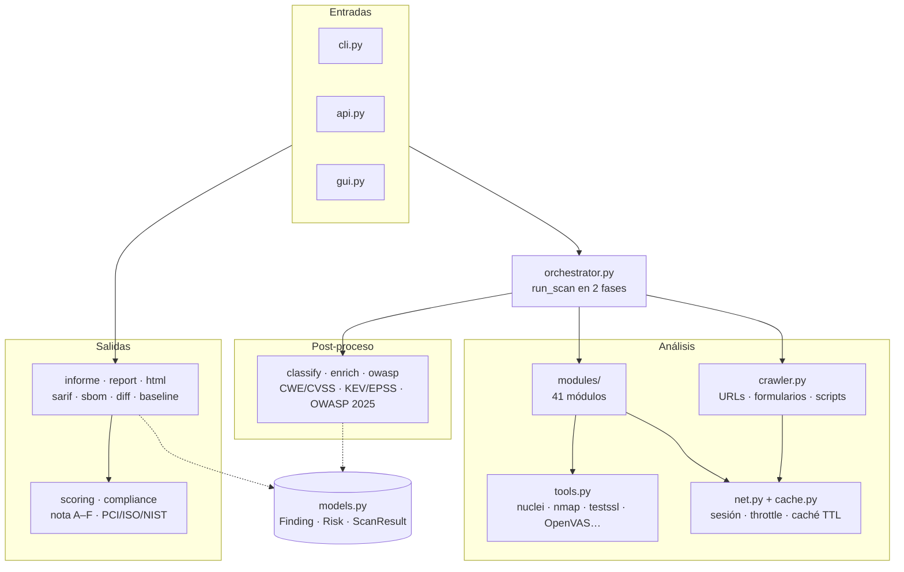
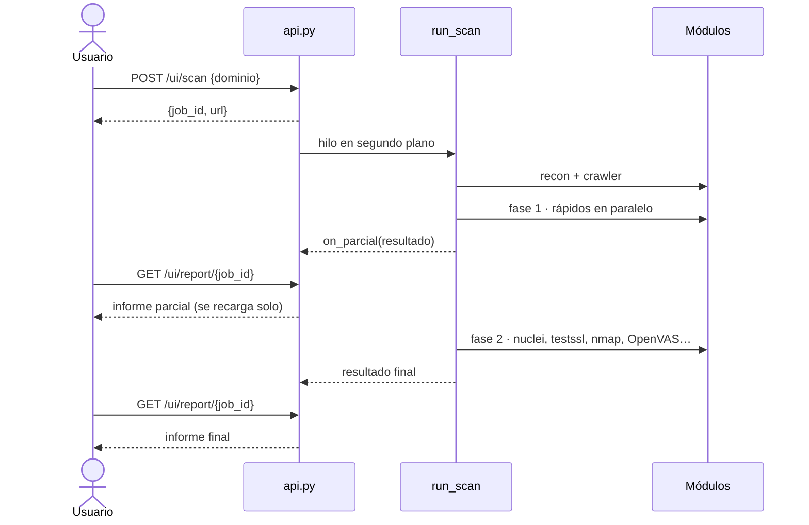
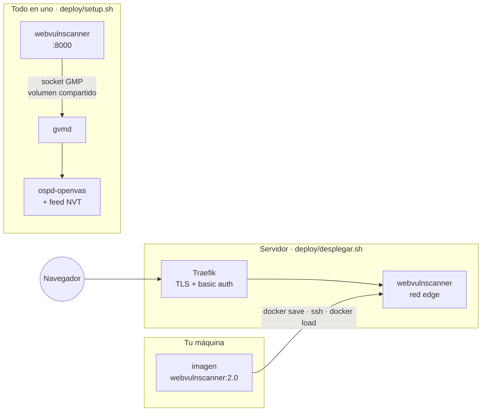

# Arquitectura

Cómo está armado WebVulnScanner por dentro: capas, flujo de un escaneo, catálogo de módulos,
motores externos, despliegue y las decisiones que explican la forma del código.

- [Capas](#capas)
- [Flujo de un escaneo](#flujo-de-un-escaneo)
- [Catálogo de módulos](#catálogo-de-módulos)
- [Motores externos](#motores-externos)
- [Despliegue](#despliegue)
- [Decisiones de diseño](#decisiones-de-diseño)
- [Laboratorio de red](#laboratorio-de-red)
- [Specs](#specs)

## Capas



| Capa | Archivos | Responsabilidad |
|---|---|---|
| Dominio | `models.py` | `Finding`, `Risk` y `ScanResult`. Sin red, sin UI, sin I/O. |
| Entradas | `cli.py`, `api.py`, `gui.py` | traducen flags, peticiones HTTP o clics a una llamada a `run_scan`. |
| Orquestación | `orchestrator.py` | ordena los módulos, los corre en paralelo, separa rápidos de lentos y arma el resultado. |
| Análisis | `crawler.py`, `modules/`, `tools.py` | cada módulo devuelve `list[Finding]`; `tools.py` envuelve los binarios externos. |
| Red | `net.py`, `cache.py` | sesión compartida (cookies, bearer, cabeceras), throttle y caché en disco con TTL para crt.sh y NVD. |
| Post-proceso | `classify.py`, `enrich.py`, `owasp.py` | CWE y CVSS v3.1, explotabilidad (CISA KEV, EPSS) y categoría OWASP Top 10 2025 / API Top 10 2023. |
| Salidas | `informe.py`, `report.py`, `html.py`, `sarif.py`, `sbom.py`, `diff.py`, `baseline.py` | informe de 3 pestañas, TXT/JSON/HTML, SARIF 2.1.0, SBOM CycloneDX, comparación entre escaneos y supresión de hallazgos aceptados. |
| Calificación | `scoring.py`, `compliance.py` | nota A–F (penaliza por riesgo, bonifica buenas prácticas) y controles PCI-DSS, ISO 27001 y NIST 800-53 afectados. |

Las dependencias apuntan hacia `models.py`: cualquier capa puede usar el modelo, el modelo no conoce a nadie.

## Flujo de un escaneo

`run_scan(dominio)` hace siempre lo mismo, la llame quien la llame:

1. Normaliza el dominio (lanza `ValueError` si no es un host válido) y aplica la sesión: auth y throttle.
2. Hace **una sola petición** a la portada y la comparte con los módulos que la leen (cabeceras, WAF, fingerprint…).
3. **Recon** primero: IP, servidor, producto y versión, que necesitan `ports`, `cve` o `nmap`. Si no hay IP, termina.
4. **Crawler**: URLs, parámetros, formularios y scripts del mismo host, para los módulos que los usan (inyección, CSRF, secretos, retire.js…).
5. **Fase 1**: los módulos rápidos corren en un `ThreadPoolExecutor` (8 hilos). Con ellos se arma un resultado parcial y se entrega por `on_parcial`.
6. **Fase 2**: los módulos lentos (`tls_deep`, `subfinder`, `testssl`, `nuclei`, `nmap`, `wpscan`, `api_fuzz`, `openvas`).
7. **Ensamblado**: hallazgos en el orden canónico del catálogo, sin CVE repetidos, enriquecidos, etiquetados y clasificados. Cada módulo queda marcado como `analizado`, `omitido` (con el comando para instalar el motor), `falló` o `en progreso`.

En la web, ese flujo corre en un hilo aparte y el navegador va recargando el informe:



El CLI usa el mismo `on_parcial` para escribir `informe.html` apenas termina la fase 1 y lo reescribe al final.

## Catálogo de módulos

La fuente de verdad son las listas `MODULOS` y `MODULOS_ACTIVOS` de `orchestrator.py`. Fase 2 = lento.

### Pasivos

| Módulo | Qué revisa | Fase | Motor externo |
|---|---|---|---|
| `recon` | DNS A/AAAA, servidor, producto y versión | antes de todo | — |
| `ports` | puertos comunes (TCP connect) y banners | 1 | — |
| `tls` | versiones de TLS, cifrados débiles, certificado, fuerza de clave, HTTP→HTTPS | 1 | — |
| `tls_deep` | Heartbleed, ROBOT, CCS injection, protocolos obsoletos | 2 | sslyze |
| `headers` | CSP, HSTS y demás cabeceras de seguridad, evaluando su valor | 1 | — |
| `dns` | MX, SPF, DMARC, DKIM, BIMI, CAA, DNSSEC, transferencia de zona | 1 | — |
| `subdomains` | subdominios por Certificate Transparency y subdomain takeover | 1 | — |
| `disclosure` | `.git/`, `.env`, backups, `robots.txt`, `security.txt` | 1 | — |
| `waf` | WAF y CDN (Cloudflare, Akamai, Fastly…) | 1 | — |
| `fingerprint` | CMS y frameworks | 1 | — |
| `stack` | tecnologías con versión y CVE por componente | 1 | Wappalyzer (opcional) |
| `wordpress` | usuarios expuestos, IP interna en wp-json, xmlrpc, readme | 1 | — |
| `frameworks` | Drupal, Joomla, Laravel (Ignition, Telescope) y paneles | 1 | — |
| `webchecks` | mixed content, SRI, formularios inseguros | 1 | — |
| `csrf` | formularios sin token anti-CSRF | 1 | — |
| `retirejs` | librerías JavaScript con vulnerabilidades conocidas | 1 | — |
| `secrets` | claves y tokens en el JS servido | 1 | detect-secrets (opcional) |
| `jwt` | JWT con algoritmos o claims débiles | 1 | — |
| `api` | OpenAPI y GraphQL expuestos | 1 | — |
| `cloud` | buckets referenciados abiertos y metadata expuesta | 1 | — |
| `mail_transport` | MTA-STS y TLS-RPT | 1 | — |
| `sbom` | componentes de la cadena de suministro y dependency confusion | 1 | — |
| `cve` | CVE por CPE de producto y versión (NVD) | 1 | — |
| `shodan` | puertos, CVE y hostnames de la IP (InternetDB gratis; Host API con `SHODAN_API_KEY`) | 1 | — |
| `subfinder` | subdominios de fuentes pasivas | 2 | subfinder |
| `testssl` | auditoría TLS completa | 2 | testssl.sh |

### Activos

Envían peticiones elaboradas al objetivo. Corren siempre: el alcance se limita con `--only`, `--skip` o `--profile`.

| Módulo | Qué prueba | Fase | Motor externo |
|---|---|---|---|
| `cookies` | flags `Secure`, `HttpOnly`, `SameSite` | 1 | — |
| `cors` | reflejo de `Origin` arbitrario con credenciales | 1 | — |
| `inyeccion` | XSS reflejado y SQLi en los parámetros descubiertos | 1 | — |
| `open_redirect` | redirecciones abiertas | 1 | — |
| `fuzzing` | rutas comunes por diccionario | 1 | — |
| `access_control` | IDOR/BOLA y forced browsing | 1 | — |
| `auth_test` | enumeración de usuarios, credenciales por defecto, session fixation | 1 | — |
| `ssrf` | SSRF y Host header injection | 1 | — |
| `error_audit` | trazas de error y modo debug ante entradas malformadas | 1 | — |
| `rate_limit` | ausencia de rate limiting (ráfaga configurable con `--rl-burst`) | 1 | — |
| `api_fuzz` | fuzzing de la API contra su OpenAPI | 2 | schemathesis |
| `nuclei` | plantillas de vulnerabilidades conocidas | 2 | nuclei |
| `nmap` | `nmap --script vuln` sobre la IP | 2 | nmap |
| `wpscan` | WordPress: plugins, temas y versiones vulnerables | 2 | WPScan |
| `openvas` | escaneo "Full and fast" con todas las NVTs | 2 | OpenVAS / Greenbone |

## Motores externos

Todos son opcionales. Si un motor no está, su módulo se marca `omitido` en el informe con el comando
para instalarlo. `webvulnscanner --check-tools` muestra el estado de cada uno.

| Motor | Módulo | De dónde sale |
|---|---|---|
| sslyze, Wappalyzer, detect-secrets | `tls_deep`, `stack`, `secrets` | extra `enhanced` (incluido en la imagen) |
| schemathesis | `api_fuzz` | extra `apifuzz` (incluido en la imagen) |
| nuclei, subfinder | `nuclei`, `subfinder` | binarios oficiales en la imagen; plantillas de nuclei precargadas |
| testssl.sh, nmap | `testssl`, `nmap` | en la imagen |
| WPScan | `wpscan` | en la imagen si la gema compila (best-effort) |
| OpenVAS | `openvas` | pila Greenbone aparte; se habla por el socket GMP con `python-gvm` |

OpenVAS queda fuera de la imagen porque su feed de NVTs tarda horas en sincronizar y necesita su
propia base de datos, Redis y scanner.

## Despliegue



### Local

La imagen sirve para el CLI (entrypoint por defecto) y para la web (cambiando el entrypoint a `uvicorn`):

```bash
docker run --rm -v "$PWD:/reports" webvulnscanner:2.0 tu-dominio.com
docker run --rm -p 127.0.0.1:8000:8000 --entrypoint uvicorn webvulnscanner:2.0 \
  webvulnscanner.api:app --host 0.0.0.0 --port 8000
```

### Todo en uno con Greenbone

`deploy/setup.sh` baja el compose oficial de Greenbone Community (`deploy/greenbone.yml`, fuera de git),
lo combina con `deploy/docker-compose.yml` y crea el usuario `admin` de GVM con `$GVM_PASSWORD`.
WebVulnScanner y `gvmd` comparten el volumen del socket GMP, así que no se expone ningún puerto de GVM.

```bash
GVM_PASSWORD='clave-fuerte' ./deploy/setup.sh   # → http://localhost:8000
```

Pide unos 4 GB de RAM y 10 GB de disco. La primera sincronización del feed tarda horas; mientras
tanto el módulo `openvas` no da resultados y el resto funciona igual. `GVM_MAX_WAIT` (3600 s por
defecto) es el tope de espera por escaneo.

### Servidor con Traefik

`deploy/desplegar.sh` construye la imagen en local (el build pesa demasiado para un servidor
compartido de 2 núcleos), sube el código a `/opt/wsa` con `rsync`, pasa la imagen por
`docker save | ssh | docker load` y levanta `deploy/docker-compose.prod.yml`.

- Variables en `/opt/wsa/.env`, a partir de `deploy/env.example`: `DOMAIN` y `DEMO_AUTH`
  (`openssl passwd -apr1`, entre comillas simples porque el hash lleva `$`).
- Traefik publica el servicio con TLS y **basic auth obligatoria**: la web corre
  escaneos activos y un reporte de abuso tumbaría el servidor entero.
- Límites: 1,5 CPU y 1 GB de RAM. Sin OpenVAS.

```bash
bash deploy/desplegar.sh            # VPS=otro-alias para cambiar el host ssh
```

## Decisiones de diseño

- **Fallo aislado.** Cada módulo corre dentro de `_ejecutar`: si lanza una excepción, queda como hallazgo informativo y el escaneo sigue.
- **Dos fases.** El informe no espera a nuclei ni a OpenVAS: sale con lo rápido y se completa después.
- **Progreso por `logging`.** Nadie imprime: CLI, GUI y API enganchan su propio handler.
- **Render puro.** `render_*` y `informe.generar` son funciones de `ScanResult` a `str`; `report.guardar` es la única que escribe a disco. Se prueban sin red ni sistema de archivos.
- **Una petición compartida.** La portada se pide una vez y la leen todos los módulos que la necesitan.
- **Caché que no se envenena.** Los fallos de red no se guardan, así que no bloquean el TTL.
- **Motores opcionales.** El núcleo solo necesita `dnspython` y `cryptography`; lo demás suma cobertura si está instalado.
- **Jobs en memoria.** `api.py` guarda los escaneos web en un `dict` de un solo proceso. Con varias réplicas habría que moverlo a Redis o a una base de datos.
- **Sin compuerta de autorización.** La herramienta corre todo siempre. La responsabilidad es de quien la opera; por eso la web de producción va detrás de basic auth.

## Laboratorio de red

`webvulnscanner.covert` es un subpaquete aparte porque trabaja en otra capa (IP, no HTTP):
oculta datos en el campo *IP Identification*, los detecta por entropía y con un clasificador
RandomForest, y los neutraliza aleatorizando el IP ID con NFQUEUE. Se instala con el extra `netlab`.
Detalle en [src/webvulnscanner/covert/README.md](../src/webvulnscanner/covert/README.md).

## Specs

`openspec/specs/` tiene una spec por capacidad de seguridad (control de acceso, autenticación,
JWT, SSRF, supply chain, mapeo OWASP 2025…) con escenarios verificables. `openspec/changes/`
guarda los cambios en curso con su propuesta, diseño, tareas e informe de verificación.
